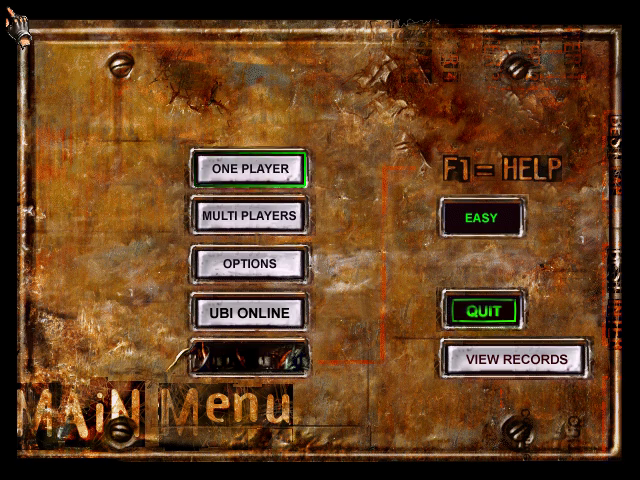
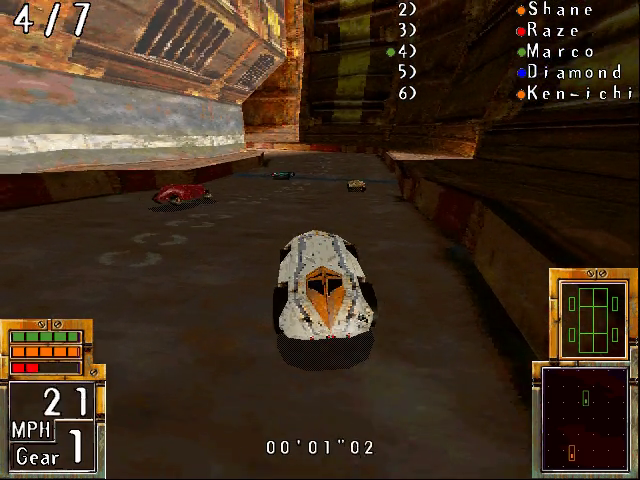
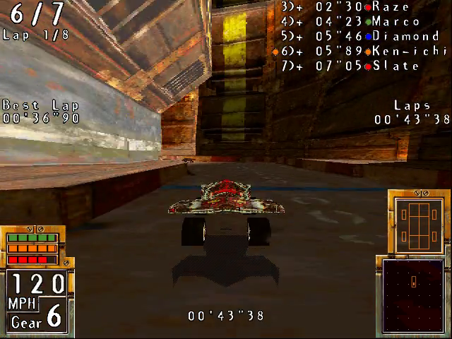
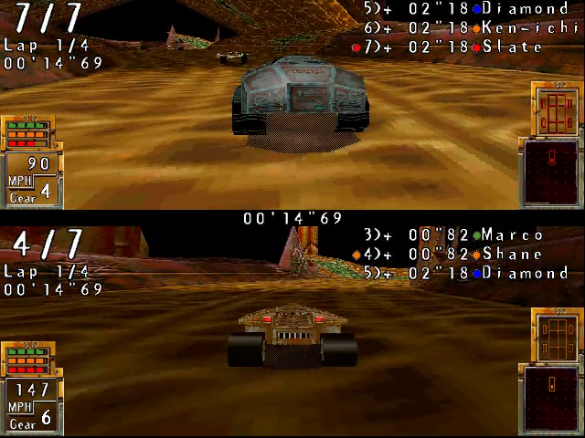

# POD Gold — Static Recompilation

```
   ____   ___   ____     ____  ___  _     ____
  |  _ \ / _ \ |  _ \   / ___|/ _ \| |   |  _ \
  | |_) | | | || | | | | |  _| | | | |   | | | |
  |  __/| |_| || |_| | | |_| | |_| | |___| |_| |
  |_|    \___/ |____/   \____|\___/|_____|____/
        " on Io, there is room for one "
```

A static recompilation of **POD Gold** (Ubi Soft, 1997): the MMX software-renderer build,
`PODMMX.EXE`, lifted from x86 machine code back to C and rebuilt as a 32-bit Windows
program that runs on a current PC, with no MMX Pentium, no 3D card and no disc in the
drive. You supply the disc; nothing of the game is in this repository.

> **POD was a gem.** A futuristic combat racer with a nasty premise: the colony planet
> **Io** is dying of a fungus dug out of its own crust, there is **one ship left**, and the
> survivors race for the only seat off-world. It was also one of the first games to ship
> on the back of Intel's **MMX**. The whole story is in [docs/HISTORY.md](docs/HISTORY.md).

Part of the [pcrecomp](https://github.com/sp00nznet/pcrecomp) family of PC static
recompilations, and built in its house style: pcrecomp's disasm32 finds the functions,
its `lift32` writes the C, and its `native32` runtime hosts it.

## Status

**Alpha, no tagged release yet.** It runs, untouched, from boot to the race and back.

| | |
|---|---|
| Boot, CD check, config, intro | ✅ (the intro stills draw to the window, not yet to `--record`) |
| Main menu | ✅ drawn, takes keys (`--key`) |
| Attract-mode races | ✅ Downtown, seven cars, **the 3D world drawn**, HUD, laps and standings; then a four-way split-screen race |
| Your own race (One Player) | ⏳ not yet driven through by a script |
| CD music | 🔇 the CD audio device answers but plays nothing |
| Videos (intro, credits) | 🚫 Indeo 4.1, which Windows no longer decodes: skipped, as if missing |
| Sound effects | ✅ through Windows' `waveOut` |
| Windowed play on a screen | ⚠️ the window and presenter are in, but only headless runs have been checked |
| Conformance | **11/11** milestones, 0 lift errors ([below](#conformance)) |

The track did not draw at all before October 2026; relifting on the current pcrecomp
fixed it. How, and every other wall on the way, is in [docs/bringup.md](docs/bringup.md).

## Screenshots

From a headless run (`--record`): the main menu, and POD's attract-mode race.









## Getting Started

You need **your own POD Gold disc**: the CD, or an image of it (`POD2_0.BIN` + `.CUE`,
or an ISO). The CD's data track is copied into `game\`; nothing is downloaded but tools.

### Quick start

1. Download this repository (Code → Download ZIP) and unzip it somewhere without an
   `&` in the path, for example `C:\pod-recomp`.
2. Double-click **`Setup.cmd`**. It checks for Python 3.10+, the `pefile` and `capstone`
   packages, the pcrecomp toolkit, Visual Studio 2022 (C++ desktop workload), CMake and
   Ninja, and asks before installing any that are missing, saying what and how big.
3. When it asks, put the CD in or paste the path of `POD2_0.BIN` (or an ISO). It looks
   in this folder and in Downloads first.
4. Wait: finding the functions, lifting and building take 20 to 60 minutes, once. A rerun
   after a failure skips the steps already done. If it stops, it says why in one line and
   keeps the details in `setup.log`.
5. Double-click **`POD Gold (recomp).cmd`**.

Setup needs pcrecomp with [pcrecomp#128](https://github.com/sp00nznet/pcrecomp/pull/128).
Until that is merged into pcrecomp's `main`, check out its branch in `..\pcrecomp`
(`git -C ..\pcrecomp checkout fix/native32-watcom-sections`) or Setup will stop and say
the toolkit is too old.

### Step by step

The same steps by hand; Setup.cmd runs exactly these.

**Prerequisites:** Windows 10 or 11; Python 3.10 or newer with `pip install pefile capstone`;
Visual Studio 2022 or its Build Tools with *Desktop development with C++*; CMake 3.20+;
Ninja; Git. [ffmpeg](https://ffmpeg.org/) on `PATH` for `--record` and the conformance run.

1. **Get the toolkit** beside this folder:

   ```
   git clone https://github.com/sp00nznet/pcrecomp ..\pcrecomp
   git -C ..\pcrecomp checkout fix/native32-watcom-sections   # until pcrecomp#128 is merged
   set PCRECOMP=%CD%\..\pcrecomp
   ```

2. **Copy the disc into `game\`**, from the image:

   ```
   py -3 tools\extract_disc.py POD2_0.BIN game
   ```
   ```
   [+] extracted 951 files, 450.0 MB -> game/
   ```
   or from the CD (`robocopy D:\ game /E`).

3. **Write the install record** POD's installer would have put in `C:\Windows\UbiSoft`.
   The recompiled game reads it from `game\UbiSoft\Ubi.ini` instead:

   ```
   [POD2_0]
   Directory=
   Language=English
   Configuration=2002
   Valid=1
   SizeView=0
   DisplayMode=0
   LetterBox=0

   [OSD]
   Directory=OSD
   Valid=2.11
   Version=2.11
   ```

4. **Find the functions** (about 5 minutes):

   ```
   py -3 tools\catalog.py
   ```
   ```
   [catalog] 6 code addresses taken as immediates are not entries: 0x0040F3E8, 0x0043F108, 0x004696F9, 0x004A0DC8, 0x004BD72C, 0x004CF938
   [catalog] 9239 functions -> ...\work\functions.json
   ```

5. **Lift to C** (under a minute):

   ```
   py -3 run_lift.py
   ```
   ```
   [*]   27 self-modified immediates: 0x004D8192, ...
   ============================================================
     lifted 9257   errors 0   no terminator 1054
     1,878,091 lines of C in 47 files (47 changed), 33.7s
   ============================================================
   ```

6. **Build** (15 to 45 minutes; the 32-bit host, with MSVC and Ninja):

   ```
   set CMAKE_ARGS=-DPCRECOMP=%PCRECOMP%
   build.cmd
   ```
   The result is `build\pod.exe`.

7. **Run it:** `build\pod.exe --run`.

Usual trip-ups: `python` opening the Microsoft Store (use `py -3`, or turn off the
*App execution alias* for python.exe); a new install not on `PATH` until a new window;
a folder path with `&` in it, which cmd.exe splits.

## Usage

```
build\pod.exe --run                                    play, in a window
build\pod.exe --run --headless --record out.mp4        no window, no screen: record 30 fps
build\pod.exe --run --headless --frames 3000 --shot 2500:frame.bmp
build\pod.exe --run --headless --key ENTER@12000 --key DOWN@14000+300
```

| Flag | |
|---|---|
| `--run` | Run the game (without it, the image is only mapped and bound) |
| `--headless` | Nothing reaches a screen: the window is cloaked, the real keyboard is ignored. Works over RDP |
| `--record FILE` | Pipe the frames to ffmpeg at 30 fps |
| `--frames N`, `--shot N:FILE` | Stop after N presents; save present N as a BMP |
| `--key NAME@MS[+HOLD]` | A scripted key, milliseconds after the window opens (`ENTER`, `ESC`, arrows, letters, `F1`...) |
| `--game DIR` | The game folder (default `game`) |
| `--watchdog S` | End after S seconds with a report of where every thread is |
| `--original` | Run the shipping machine code under the same host, for comparison |
| `--native-trace`, `--callbacks`, `--ddraw-trace` | Every call to Windows; every call from Windows into the game; every DirectDraw call |

With no input, POD's menu starts a race by itself after a few seconds (attract mode),
so `--headless --record` alone shows the menu, a race, the menu again, then a
four-way split-screen race.

## Conformance

`py -3 tools\conformance.py` runs the host headless for 120 seconds and scores eleven
milestones (image bound, the CD found, DirectDraw, past the CD and sound checks, the
menu, the attract race starting, the 3D world drawn, the race moving, back to the menu,
a second attract race after the video, no fault) from its output and its recording, plus lift health from the generated tree.
It compares against [`conformance.json`](conformance.json) and fails on any drop.

**Current: 11/11 milestones; 9,257 functions lifted, 0 errors, 3 unresolvable tail labels.**

The corpus is your disc, which cannot be redistributed: without `game\`, a lift and a
build, the harness prints `SKIP` and exits 0.

## Building from source

The lifted C is generated on your machine from your copy and is never committed: the
`src\recomp\gen\` it builds from is the output of step 5 above, and `work\` holds the
catalog. `build.cmd` (steps 1 to 6) is the whole build. In the author's lab the build goes
to [netlab](https://github.com/sp00nznet/recomp-netlab) instead (`netlab build pod-recomp`,
about a minute on the farm), and `tools\conformance.py` is its QA step.

How the pieces fit is in [docs/architecture.md](docs/architecture.md); the disc is described
in [docs/DISC.md](docs/DISC.md) and the executables in [docs/BINARIES.md](docs/BINARIES.md).
Changes are in [CHANGELOG.md](CHANGELOG.md), what's next in [ROADMAP.md](ROADMAP.md), and
how to help in [CONTRIBUTING.md](CONTRIBUTING.md).

## License

The code in this repository is released under the [MIT License](LICENSE).

That covers this project's own work: the host runtime, the DirectDraw and DirectInput
layers, the lift driver and catalog tools, the setup and test scripts, and the docs.

It does not cover POD or POD Gold. The game's executable, data and assets belong to
Ubi Soft and are not distributed here. Neither is the lifted C: it is machine-translated
from the original `PODMMX.EXE` and carries whatever rights the executable does, so it is
generated on your machine, from your copy, and never checked in. The screenshots show
this project's output running against a disc you supply; the artwork in them is the
game's.

---

*POD and POD Gold are © Ubi Soft Entertainment. This project recompiles a binary you must
own; it ships no game code or assets.*
