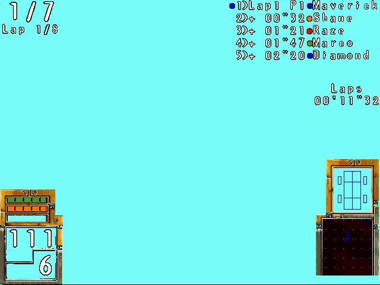

# Phase 3 — runtime bring-up

Phase 3 turns the compiled translation units into a **host executable that maps
`PODMMX.EXE` into a simulated address space and actually executes its code**,
starting from the Watcom CRT entry point. Architecture follows the sister project
`fury3` (the first in the family to boot into its main loop).

## What was built

| Piece | File | Role |
|-------|------|------|
| Runnable lifter | `run_lift.py` | global x87 FPU stack, `RECOMP_ENTER` tracing, intra-function switch/jump-table dispatch (vs the Phase-1 `run_pipeline.py`) |
| Runtime core | `src/runtime/recomp_runtime.c` | arena memory, PE image loader, dispatch, VEH, file/INI/display host I/O, entry call |
| Import bridges | `gen_imports.py` → `src/runtime/imports_gen.c` | a stdcall-correct shim per imported function + the `{iat_va → shim}` bridge table (231 bridges) |
| Hand-written shims | `src/runtime/shims_impl.c` | CRT-critical Win32 (`GetVersion`, command line, std handles, heap, file I/O, INI, window/DIB, TLS, `ExitProcess`, …) |
| DirectDraw/DirectInput COM shim | `src/runtime/ddraw_shim.c` | fake `IDirectDraw`/`IDirectDrawSurface`/`IDirectDrawPalette` + `IDirectInput`/`IDirectInputDevice` (synthetic-VA vtables); DirectDraw backed by a window + 16bpp present |
| Fn-pointer / OOB closure | `tools/seed_fptr_targets.py` | adds code addresses taken as pointers (handler tables) as entries; stubs out-of-range misdisassembly artifacts |
| CD/config/CPU shims | `src/runtime/shims_impl.c` + `game_files/UbiSoft/Ubi.ini` | CD-ROM drive + volume label, `VirtualQuery`, CPU-detect replacement, TLS, valid `Ubi.ini` |
| Threading + sync | `src/runtime/thread_shim.c` | real host threads (per-thread `RECOMP_TLS` registers), events/mutexes/semaphores/critical-sections |
| Closure pass | `tools/seed_call_targets.py` | adds direct **call and jump** targets IDA didn't catalog (incl. cross-function switch arms) as entries, iterating to a fixed point |
| Build | `CMakeLists.txt` | links runtime + bridges + 3,601 lifted functions into `pod_recomp.exe` |

```
py -3.11 run_lift.py            # x86 -> C (runnable variant)
py -3.11 tools/seed_call_targets.py   # close the direct-call set
py -3.11 gen_imports.py         # import bridge layer
cmake -B build -A Win32 && cmake --build build --config Debug
build/Debug/pod_recomp.exe analysis/PODMMX.EXE --run
```

## Memory model

The host EXE is linked at a high base (`/BASE:0x70000000 /DYNAMICBASE:NO`). At
startup the runtime reserves **one arena** wherever Windows has room and points
`g_mem_base` at it; every guest VA `v` lives at host `g_mem_base + v`, so the
whole guest space is addressed transparently through the `MEM`/`ADDR` macros:

| Region | Guest VA | Notes |
|--------|----------|-------|
| TIB/TEB | `0x00100000` | SEH chain head, stack base/limit, self — for `fs:[…]` |
| Stack | `0x00200000`–`0x00300000` | 1 MB; `esp` starts near the top |
| Image | `0x00400000`–`~0x0078E000` | PODMMX sections at their real VAs; `.bss` zeroed |
| Heap | `0x00800000`–`0x08800000` | 128 MB bump + free-list for shim allocations |

(An earlier fixed-map-at-`0x400000` attempt failed: with the host linked high, the
CRT's own heap lands in low memory before our code runs — hence the arena.)

## How far it boots ✅

From the Watcom CRT entry (`sub_004C9FD8`), the recompiled code runs **~200
function entries (57 distinct functions) of real CRT initialization** before
stalling, exercising 9 distinct Win32 imports along the way:

```
VirtualQuery, GetCurrentThreadId, GetModuleFileNameW, GetCommandLineW,
SetUnhandledExceptionFilter, TlsAlloc, InitializeCriticalSection, TlsSetValue, ...
```

That's TLS setup, exception-filter install, command-line/heap probing, critical
sections, and the start of the CRT's **init/fini function-pointer table walk**
(`sub_004CA4EA`/`sub_004CA536`, records `{type, priority, func}` sorted by
priority) — i.e. the C runtime is genuinely coming up.

## Jump-table / cross-function control flow ✅ resolved

The earlier derail around `0x004CB3xx` (registers holding code addresses; an
indirect call reading code bytes as a pointer, `ITAIL: unresolved 0x004CB4DC` …)
was a **direct jump whose target lands inside a *neighbouring* IDA function.** The
lifter can only `goto` a label in the *same* C function, so for an out-of-function
target it emits `L_X: RECOMP_ITAIL(0xXu)` — a global tail-call. That misses the
dispatch table whenever `X` isn't a catalogued entry (a switch arm / mid-function
landing), so the jump is silently dropped and control flow is lost.

**Fix — close the control-flow target set** (`tools/seed_call_targets.py`): scan
the generated code for every literal `RECOMP_CALL(sub_X)` **and**
`RECOMP_ITAIL(0xXu)` target, add any that isn't already a dispatch entry to the
IDA catalog with bounds `[X, next-known-start)`, re-lift, and iterate to a fixed
point. A mid-function target becomes its own `sub_X` (re-lifting the tail of the
host function); since registers/stack are global, tail-calling it continues
execution correctly. Closed at **3,601 functions** (≈190 added over 5 iterations).

**Result:** `ITAIL: unresolved` went from looping-forever to **0**. Execution
advanced from 57 → **76 distinct functions** and now runs cleanly through the
CRT init/fini table walk. (One stray `ICALL: unresolved 0x004D23A3` remains — an
init-table *function pointer* IDA didn't catalog; an indirect target, so it needs
table-content analysis rather than the literal-scan closure.)

**Other fixes landed this phase:**
- Unresolved-`ICALL` no longer leaks 4 bytes of `esp` per call (was `esp += 4`
  with nothing pushed) — cut the earlier stall's log from 425K lines to a clean stop.
- `test r,r` followed by `jbe/ja/jb/jae/jg/jge/jle` now lifts to the correct
  ZF/SF-vs-0 test instead of a bogus `CMP_*(a,b)` (after `test`, CF=OF=0).
- Watcom `.bss` (SizeOfRawData≠0, PointerToRawData=0) is left zeroed, not
  overwritten with file bytes.
- Segment registers `fs`/`gs` map via capstone's symbolic IDs (stale numeric IDs
  broke `pop fs`/`pop gs`).

## CRT-heap `memset` overrun ✅ resolved (a shift-flags lifter bug)

The access violation deeper in init was Watcom's `memset` fill loop
(`sub_004CA197`) running with `ECX = 0xFF800026` (~4 GB) off the end of the arena.
Root cause: **`shl`/`shr`/`sar` didn't update the lifter's flag state.** In
`memset`, `shr ecx, 2 ; je …` decides whether to enter the unrolled fill — but the
lifted `je` consumed the *previous* instruction's (`dec`) stale ZF, took the wrong
branch, and let `ecx` underflow (`dec` from 0 → `0xFFFFFFFF`) into a multi-GB
count. Fix: the shift handlers now capture their result and set a result-vs-0 flag
state, so a following `jcc` tests the shift's ZF/SF. (Broad win — shift-then-branch
is everywhere.) Also fixed: real **TLS** (`TlsAlloc/Free/Get/SetValue` back a slot
table — the stubs made every guest thread-data lookup fail in a tight loop,
"Thread has no thread-specific data").

## How far it boots now ✅ — full startup, graceful exit

The recompiled `PODMMX.EXE` runs its **entire boot sequence** — **378 function
entries** — with no crash:

```
Watcom CRT init  →  WinMain  →  game startup
  CreateMutexA, InitializeCriticalSection, GetDriveTypeA, GetLocaleInfoA,
  GetWindowsDirectoryA, RegisterWindowMessageA, LoadCursorA, SendMessageA,
  SetClassLongA  →  DirectDrawCreate
```

It reaches **graphics initialization**, and because `DirectDrawCreate` is stubbed
to return `E_FAIL`, the game does exactly what the original would on a machine with
no DirectDraw: pops its **own** `MessageBox` — *"POD Fatal error: DirectDrawCreate
failed"* — and calls `ExitProcess(-1)`. The recompiled game is executing its real
logic end-to-end through the HAL boundary.

## DirectDraw COM shim ✅ — graphics init runs, window opens

`DirectDrawCreate` now returns a real **fake COM object** (`src/runtime/ddraw_shim.c`).
COM objects are synthesised in *guest* memory as `{ vtbl_va, fields… }`; each vtable
is an array of **synthetic method VAs** (`0xCD000000 + index`). A virtual call
`call [vtbl+off]` lifts to `RECOMP_ICALL(synthetic_va)`, which `recomp_lookup_import`
resolves (via `pod_com_lookup`) to the matching host method shim — each running in
the recomp stack model (`this=ARG(0)`, args `ARG(1..)`, `RET(hr)`, `STDRET(slots)`).

Implemented `IDirectDraw` (23 methods), `IDirectDrawSurface` (36), and a minimal
`IDirectDrawPalette` (7). The real-behaviour ones: `SetDisplayMode` opens/sizes the
window; `CreateSurface` builds a primary (+ optional attached back buffer) and an
offscreen surface with a 16bpp guest pixel buffer; `Lock` hands back that buffer's
VA in the `DDSURFACEDESC` (565 pixel format) so the MMX rasterizer renders straight
into it; `Flip`/`Blt`/`BltFast` present it to the window via `StretchDIBits` (16bpp
`BI_BITFIELDS`).

**Result:** the recompiled POD runs its real graphics init end-to-end through the
shim — `DirectDrawCreate → SetCooperativeLevel(FULLSCREEN) → EnumDisplayModes →
CreateSurface(primary, 640×480) → CreateSurface(offscreen system-mem render target)`
— and a 640×480 window opens. The game is past the HAL boundary and into its loop.

## Full startup → game loop ✅ — reaches WinMain's message loop

A run of fixes took POD all the way through its real startup to the game loop:

- **Path translation bug.** `host_translate_path` stripped `(f-low)+6` for a
  `"pod/"` match (a `"fury3/"`=6 leftover) — corrupted any path containing `pod/`.
  Fixed to `+4`.
- **CD-ROM check** (`sub_4736E4`): scans drives A–Z for a CD-ROM whose volume label
  matches. Shimmed `GetDriveTypeA` (D: = CD-ROM) + `GetVolumeInformationA`
  (label `POD2_0`). Without it, POD loops "Please insert POD CD-ROM".
- **`Ubi.ini` config.** POD reads `<WinDir>\UbiSoft\Ubi.ini` (`[POD2_0]`
  `Configuration`/`Language`/`Directory`, `[OSD]` `Valid`/`Directory`). Supplied a
  `game_files/UbiSoft/Ubi.ini` (`Configuration=2002` = "Playable config for MMX",
  per the disc's `INSTDATA/UBI.ENG`). The hardcoded `pod2_0\pod2_02.exe` /
  `startup.exe` / `Client.exe` are the Ubi Game-Service self-relaunch chain — absent
  = run in-process.
- **CPU detection** (`sub_4A2DBC`): probes CPUID via the EFLAGS ID-bit toggle, then
  maps vendor+family to a renderer class in `dword_6E7290` (WinMain bails if it's not
  1–8). Our model carries no EFLAGS, so the probe failed → bail. Replaced the
  function (`HOST_SHIM`) with a host shim reporting a Pentium-MMX Intel (class 2).
- **`VirtualQuery`**: a real implementation over the arena (the stub returned 0, so
  the CRT's memory-scan loop never advanced — an infinite spin in `sub_4A8560`).
- **Function-pointer closure** (`tools/seed_fptr_targets.py`): IDA leaves ~771 code
  addresses uncatalogued because they're reached only through pointers (handler
  tables). Added them as entries so indirect calls resolve. Out-of-range
  misdisassembly artifacts get empty stubs (`recomp_stubs.c`).
- **DirectInput COM shim** (in `ddraw_shim.c`): fake `IDirectInput` (8 methods) +
  `IDirectInputDevice` (18), so `DirectInputCreateA` succeeds (was `E_FAIL` →
  "Error loading Dinput.dll" fatal).

**Result — the recompiled POD runs its entire startup:** CD check → `Ubi.ini`
config → CPU detect → **DirectDraw** init (`SetDisplayMode 640×480×16`,
`CreateSurface` primary+backbuffer flip chain, 640×480 window) → **DirectInput**
(create device) → into **WinMain's `MsgWaitForMultipleObjects` game loop**.

## Threading ✅ — the game runs its real multi-threaded logic

POD is **multi-threaded**, so the runtime now runs each guest thread on a real host
thread (`src/runtime/thread_shim.c`):

- **Per-thread CPU state.** The register/FPU/segment model is now `RECOMP_TLS`
  (thread-local); the simulated memory (the arena) stays shared, like a real
  process. `ebp` and the flag temps were already per-call (C locals).
- **`CreateThread`** allocates a guest stack + TIB, then `_beginthreadex`s a launcher
  that sets that thread's `esp`/FPU/`fs_base`, pushes the thread argument, and calls
  the lifted thread proc through the dispatch table. `CREATE_SUSPENDED`/`ResumeThread`
  honoured.
- **Real synchronization.** Events, mutexes, semaphores, and `MsgWait`/`WaitFor*`
  map to real Win32 objects (a guest-handle table); critical sections map guest
  `CRITICAL_SECTION` pointers to host ones. The shim heap is lock-guarded.

**Result:** the recompiled POD runs its genuine multi-threaded logic — the main
thread drives **WinMain's `MsgWaitForMultipleObjects` message loop** while worker
threads synchronize on events/semaphores. In one run it executed **~30 million
function calls**, loaded its menu/track/car data (`circuits.bin`, `voitures.bin`,
`DIC_MNU/GAM/ERR.BMD`), and performed a **second DirectDraw init** (entering the
game proper) — all without crashing.

## Current frontier 🚧 — first rendered frame

The recompiled POD runs its **full engine** and **no longer crashes**: it completes
both DirectDraw inits, loads the menu/track/car data and every circuit sound bank
(`City`, `Galleria`, `Burrow`, `alderon`, `Sewer`, `Cocoon`, `HQ`, `Azthec`), and
then sits in WinMain's message loop running its 555→565 pixel conversion
(`sub_00475F00`) between waits. But no frame reaches the screen yet.

**What was in the way — a lifted function that fell off its end.** IDA carves
Watcom's shared tails into separate functions, so a fragment like `sub_004C5734`
(`add eax,0x19220; lea eax,[eax]`) has no `ret`: it falls through into
`sub_004C573C`. The lifter emitted a bare `return` there, which skips the `ret`
that would have popped the dummy return address — so the **caller's `esp` stayed 4
bytes low for the rest of its body**. It surfaced two calls later as a stack struct
read one slot off: `sub_00463734` (the encrypted data-cache writer) got a buffer
pointer of `0x50000000` instead of `0x01152004` and faulted on the first XOR.
`run_lift.py` now tail-dispatches to the fall-through address instead —
`RECOMP_ITAIL(next)` pushes no return address, so the real `ret` at the end of the
chain pops the caller's. **565 functions** were falling off their end this way.

Nothing here was the "encrypted data-cache writer" being hard; it was one truncated
function 224K calls earlier.

## The menu is on screen 🎉


640x480x16, locked, drawn and flipped by the recompiled MMX rasterizer, presented
with `StretchDIBits`. Dump one yourself with
`POD_FRAME_DUMP=frame.bmp POD_FRAME_DUMP_N=90 pod_recomp.exe analysis/PODMMX.EXE --run`.

**What was in the way — the game's WndProc was never called.** `DispatchMessageA`
was a stub, `RegisterClassA` threw the `WNDCLASS` away, and `RegisterWindowMessageA`
returned **0** — which is `WM_NULL`. POD drives its state machine with private
messages it registers and posts to itself (`MSG_InitSnd`, `UserMsg_InitCD`,
`UserMsg_PlayCD`, `USERMSG_INITERROR`, …), so all of them collapsed onto the same
dead id and were then dropped by a pump that dispatched window messages to *our*
host proc instead of the game's. The runtime now captures `lpfnWndProc` from
`RegisterClassA`, hands window messages for the game's window back to the game,
and `DispatchMessageA` calls POD's WndProc (`0x004A0DC8`) through the dispatch
table. `SendMessageA`, `PostMessageA` and `DefWindowProcA` are real too.

## The frame is clean — self-modifying code, and MMX

The first menu frame was 10.6% salt-and-pepper speckle and the run died after ~60
flips. Both had one cause.

**POD's 2D blit library patches its own immediates.** The font blitter is

```
004D8470  mov  dword ptr [0x4D8499], ecx   ; the glyph width, into the cmp below
004D847C  mov  dword ptr [0x4D84A1], edx   ; the surface pitch, into the add below
...
004D8497  cmp  ecx, 0x1234567              ; <- placeholder in the file
004D849F  add  edi, 0x12d687               ; <- placeholder in the file
```

A lifted binary is static C, so those stores went nowhere and the loop ran with the
author's placeholder sentinels: 19 million iterations per row, and a destination
advancing 1.2 MB per line. It sprayed the whole frame and eventually walked a glyph
pointer off the arena, which is what `sub_004A7260` was dying on. **27 immediates**
across `0x004D81xx-0x004D85xx` are patched this way.

`run_lift.py` now finds every absolute dword store into the code range up front
(`find_patch_sites`), and `lift32` sources an immediate from `MEM32(site)` when the
program writes onto it. Speckle went 10.56% → 2.79%, against 2.64% for a reference
image expanded straight from the game's own 8bpp source and palette — i.e. what is
left is picture detail, not error. Outside the areas the game redraws each frame,
586 pixels of 307,200 differ from the source art.

**MMX is implemented too.** Not a single MMX instruction was lifted — on the MMX
build. `movq`, `punpck*`, `pmulhw`, `pmaddwd`, `paddsw`, the shifts and the rest now
have a per-thread 64-bit register file in the runtime and a lifter that emits it.
This did not change the menu (a 2D palettized path) but the software rasterizer is
made of it.

## The menu responds, and a race loads

Keyboard input is wired: real host keys whenever our window is in the foreground,
plus `POD_KEYS="6000:RETURN,11000:DOWN"` — a millisecond timeline, so a headless run
can walk the menus. Keys reach the game two ways, because POD reads them two ways:
a 256-byte DirectInput state array (scancodes come from `MapVirtualKey`, so DIK_*
needs no table) and posted `WM_KEYDOWN`/`WM_KEYUP`.

RETURN on **ONE PLAYER** works. POD switches to its loading screen and loads the
Downtown circuit for real:

```
Data/Binary/MIMG/62.img              Data/Binary/resson/DownTown.MEG
Data/Binary/Circuits/DownTown.BL3    Data/Binary/resson/bakar.MEG
Data/Binary/Polices/Habilage.BP3     ... dopple, shivan, saber, scorp, arc, av1
Data/Binary/Scripts/habi.bin
```

That is the circuit geometry, the HUD skin, and all seven cars' sound banks.

> The `[io]` log was capped at 80 lines, which is why the whole race load looked
> like it never happened. `POD_IO_LOG=0` prints every open.

## It races 🏁



Position 1/7 on lap 1 of 8 at Downtown, 111 MPH in sixth, lap time `00'11"32`, and
the standings board keeping real gaps to Shane, Raze, Marco and Diamond. The
countdown runs, the car accelerates through the gears, the AI races, the clock
ticks. Everything but the world.

**What was in the way: `fmulp st(5)` was being lifted as `fmulp st(1)`.**

x87's pop-arithmetic takes a destination register — `fOPp st(i), st(0)` computes
into ST(i) and *then* pops, so the result lands in st(i-1) once the stack shifts.
The lifter ignored the index and wrote into st(1) every time, and had the
subtract/divide direction reversed on top of that (`fsubp st(i)` is
ST(i) − ST(0), not the other way round). For `faddp st(1)` — the overwhelmingly
common form, and the only one XWA and Fury³ ever exercised — that happens to be
right, which is why it survived this long.

POD's fixed-point 3D helpers are hand-written x87 that uses the whole stack:
`sub_004D4E5F`, the cross product, does `fsubp st(3)` and `fmulp st(5)`. With
every one of those computing on st(1), the cross product came out with a z
component too large for `fistp`, which stored x87's *integer indefinite*
`0x80000000`. That poisoned the squared-length helper, which made
`sub_00423BC0`'s normalise divide by `0x80000000` and turn a clean `(0, 0, 1.0)`
into `(0, 0, 0)`, which reached the camera basis, which failed to normalise, which
tripped POD's own `("3D","NORM")` check and called `exit(-1)`.

One wrong register index, six layers down.

It completes laps: **best lap 00'37"17**, 121 MPH in sixth, position and gaps to
Marco, Raze, Diamond, Ken-ichi and Slate all updating. 27,481 flips in 40 seconds
with no faults.

## Build configurations

`RECOMP_TRACE` — the function-entry ring, the shadow call stack and the stack-leak
check — is a call plus several checks on **every** lifted function entry, and POD
makes tens of millions of them per race. It is now Debug-only, along with `/Od`;
Release gets `/O2` and none of the hooks. Bring a subsystem up in Debug, then run
the game in Release:

```
cmake --build build --config Release
build/Release/pod_recomp.exe analysis/PODMMX.EXE --run
```

## Current frontier 🚧 — the world does not draw

The HUD, sprites and text render; the track does not. What is established:

- The renderer runs. `sub_004D687C` (an MMX full-screen fill, 640x480 pitch 1280)
  clears the frame, and `sub_004980E0` dispatches primitives to five span fillers
  at `0x00481C28..0x00481F58`.
- Primitives *are* dispatched and drawn — the type nibble at `[obj+0xA]>>16` comes
  through as 0x14 and 0x64, both of which the dispatcher handles.
- But the spans describe the whole viewport: `y 0..479, x ..639`. Every primitive
  covers the screen, so the last one wins and the world is one flat colour.
- The camera basis is healthy — three orthonormal unit vectors tracking the car.
- The MMX helpers are not the problem: `runtime/recomp32/mmx_selftest.c` in
  pcrecomp checks all of them against hand-worked values and passes.

So the projection is producing degenerate screen coordinates for every polygon,
and the next step is the transform that feeds `sub_004980E0` rather than the
rasterizer below it. Worth remembering that the 19 MMX functions at
`0x004C6F70..0x004C81E1` are the **sound** mixer, reached from `0x004B9xxx` — not
the rasterizer, which is plain integer code.

## Previously — one overflowed `fistp` short of a race

POD does not even need the keypress: the menu has an attract-mode timeout and starts
Downtown on its own after a few seconds. Either way it gets as far as scene setup and
then hits its own sanity check.

The chain, traced end to end:

1. `sub_004247F8` builds a face normal — two edge vectors, each normalised, then
   crossed. It writes one whose z is **`0x80000000`**. That is x87's *integer
   indefinite*: an earlier `fistp` was handed a value too big for 32 bits. Sampled
   triangles have perfectly sane 16.16 vertices (`FF03D6DA FEFA15B8 0000DD18`), so
   only some inputs blow up.
2. `sub_004D502D` (squared length) is then handed that vector, takes its
   large-magnitude path and returns `0x80000000`.
3. `sub_00423BC0` (normalise, with a unit-axis fallback when the length is zero)
   sees a *non-zero* length, so it divides — and every component of a small vector
   divided by `0x80000000` rounds to zero. A clean `(0, 0, 1.0)` becomes `(0, 0, 0)`.
4. That zero reaches the camera basis. `sub_0041DE6C` differences two points through
   it, `sub_00423E2C` cannot normalise the result, and POD calls its own error
   reporter `sub_00492FAC("3D", "NORM")` — which `SendMessage`s the message to the
   WndProc and then `exit(-1)`s. The process parks in that modal path with the
   loading screen frozen on screen.

The camera copy itself is *not* the bug: right after `sub_0041D0C0` runs, the three
basis vectors are a clean identity matrix. The zero arrives later, from step 3.

*(Resolved — it was the pop-arithmetic destination register, above. The `fistp`
was overflowing because the cross product it fed had been computed on the wrong
x87 registers.)*

Also still open: a stray sprite in the top-left corner, the fifth menu button draws
its plate but not its label, and the intro video is stubbed. POD's intro is an **IV41 (Indeo 4.1) AVI**
  through `DrawDibDraw`/`AVIFile*`. It ships its own codec —
  `game_files/INSTALL/IR41_32.DLL`, a 32-bit PE VFW driver exporting `DriverProc` —
  and this build is 32-bit, so the lazy path is to bridge `MSVFW32`/`AVIFIL32` to
  the real Windows DLLs (still present in SysWOW64) and `ICInstall` the shipped
  driver, rather than lift a codec. `encarta/tools/indeo/runtime/ir32_vfw.c` is the
  working reference for the ICM plumbing; `gta/src/engine/iat_bridge.c` for the
  generic real-API bridge.

**Infrastructure in place for when rendering engages:** `host_present16` (16bpp 565
StretchDIBits), a DirectDraw-surface registry + `auto_present_dd` in the message pump
(presents whichever surface has content), and per-thread call-ring + null-call/quit
diagnostics.

**Minor:** `ICALL: unresolved 0x004D23A3` (init-table funcptr; indirect target).

## Bring-up instrumentation

- `-DRECOMP_TRACE` (on in the Debug build) records every function entry in a ring
  buffer; `recomp_dump_trace()` prints the last 256 on a fault or watchdog trip.
- **Shadow call stack.** The lifted `ret` pops a dummy return address, so the host
  stack carries no usable backtrace. `RECOMP_CALL`/`RECOMP_ICALL` push the caller's
  VA onto a per-thread array; `recomp_dump_stack()` prints it on a fault. This is
  what named the `0x0049FE3C → … → 0x00463734` chain above in one run.
- **Stack-leak check.** A callee must not return below the caller's `esp`.
  `RECOMP_STACK_CHECK` reports each offending (caller, callee) pair once — how the
  fall-off-the-end bug was found. One known leak remains: `0x004A0420` recursing
  into itself, 4 bytes.
- The VEH names the faulting address: which module it is in, or which guest VA it
  maps to inside the arena.
- **Write watchpoint.** `POD_WATCH_ROW=<n>` makes the page holding that scanline of
  the back buffer read-only and reports, with a call stack, every distinct function
  that writes to it. Nothing in a lifted binary announces which function is the
  blitter; this is how `sub_0049C81C` (background), `sub_0049CA50` (sprites) and
  `sub_00490940` (text) were each identified.
- **Frame snapshots.** `POD_FRAME_DUMP=<file> POD_FRAME_DUMP_N=<n>` writes the nth
  presented frame as a BMP. `POD_DUMP_AFTER=<va>` (optionally gated by
  `POD_DUMP_ARM=<va>`) snapshots the back buffer the moment that function returns,
  which is how one drawing pass gets separated from the next.
- **All threads at once.** `recomp_dump_all_rings()` prints every guest thread's
  shadow call stack and recent history, not just the calling one — a hang is a
  question about the threads you are *not* in, and this is what showed the game
  thread parked inside POD's error reporter.
- **`POD_ARGS_AT=<va>`** prints a function's arguments on entry: registers (Watcom
  passes in eax/edx/ebx/ecx), the stack, anything that points at a printable string,
  and what pointer-shaped registers point at. POD names its own failures through it
  — `("3D","NORM")`, `("SOUND","UNKNOWN")`, `"DownTown.lev"`.
- **`POD_POLL_VA=<va>`** samples three dwords on every function entry and reports
  each change with the call history around it. Slower than the page trap and it
  cannot miss a write, which is what a busy page needs. This is what followed the
  camera basis from identity, to zero, back to identity.
- **`POD_RET_PRINT`** with `POD_DUMP_AFTER=<va>` prints a function's return value —
  the only way to see what a lifted leaf actually computed.
- `tools/seed_icall_targets.py` feeds a run's `ICALL: unresolved` reports back into
  the function catalogue: a function referenced only by a pointer in a table is
  invisible to IDA and to the literal scan, but the runtime names it.
- A watchdog in `recomp_lookup_import` dumps the trace and exits after 64 repeated
  unresolved indirect calls (a wild-pointer loop), instead of spinning forever.
- A VEH handler reports access violations with register + indirect-call context.
